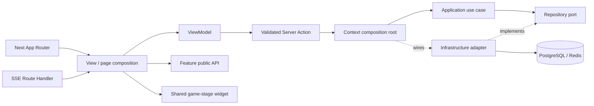

# Arquitetura da aplicação web

## Escopo deste mapa

Este documento descreve a aplicação Next.js em `web-app/`. As práticas de MVVM, Feature-Sliced Design (FSD), Atomic Design e DDD são adotadas no recorte dos fluxos de lobby, partida multiplayer, desafio solo, votação de notícias e nos contextos de servidor `rooms`, `news-voting` e `global-challenges`. A migração não declara essas práticas concluídas para todo o repositório.

## Frontend: App Router, MVVM e FSD

- `src/app/` contém rotas, layouts, Server Actions, Route Handlers e composition roots. A pasta `api/` concentra a borda HTTP e módulos de servidor por contexto.
- `src/views/` é a camada de composição de páginas do projeto. O nome evita criar `src/pages/`, que o Next.js trataria como Pages Router legado; no mapa FSD, `views/` cumpre o papel de `pages/`.
- `src/views/{room-lobby,room-game,challenge}/model/` mantém estado do fluxo, efeitos, presença, navegação, chamadas a actions e adaptação de DTOs nos ViewModels. Os arquivos `ui/` compõem a tela e delegam seções locais a componentes menores.
- `src/features/news-voting/` possui a interação de votação, seus tipos, estado local de `NewsCheckStage` e apresentação do artigo, opções e reflexão. Sua `index.ts` define a API pública.
- `src/widgets/game-stages/` publica etapas completas reutilizadas por sala e desafio solo. O consumo é feito pelo `index.ts`; uma view não importa arquivos internos de outra view.
- `src/components/` contém elementos reutilizáveis organizados por Atomic Design: átomos são primitivas, moléculas compõem controles e organismos reúnem seções compartilhadas. Componentes específicos do lobby permanecem junto à sua view enquanto não houver outro consumidor.

O sentido de dependência entre camadas de UI é: `views` podem compor `features`, `widgets` e componentes compartilhados; as camadas inferiores não importam views. ViewModels importam as APIs públicas e contratos necessários, não adapters de persistência.

## Backend: DDD parcial por contexto

Os contextos alterados ficam em `src/app/api/{rooms,news-voting,global-challenges}/`:

- `entities/` contém entidades, value objects e regras de domínio sem tipos do schema Drizzle.
- `usecase/` coordena operações de aplicação e recebe suas dependências por interfaces obrigatórias.
- `repositories/*.interface.ts` define ports de persistência usando propriedades de domínio, DTOs ou read models; não expõe linhas Drizzle.
- `repositories/drizzle-*.repository.ts` implementa os ports e mapeia entre persistência e os contratos da aplicação.
- `composition-root.ts` monta os casos de uso com adapters concretos. Actions mantêm a validação de entrada e invocam essa composição.

`src/server/shared/domain/game-vocabulary.ts` contém somente o vocabulário estável de classificação compartilhado pelos contextos. Agregados e regras de pontuação continuam separados: a sala usa resultados autoritativos de rodada do servidor; o desafio solo mantém seu contrato de XP próprio.

Essa é uma aplicação parcial de DDD/arquitetura hexagonal, limitada aos três contextos acima. Outros módulos e contextos ainda podem ter convenções anteriores. O recorte remove as violações encontradas nessas fronteiras, sem declarar dívida técnica zero para todo o sistema ou para mudanças futuras.

## Fluxos principais

## Contratos e limites

- Server Actions preservam validação, autenticação/autorização e formato de retorno existentes.
- Pontuação e correção exibidas na UI vêm dos resultados persistidos ou dos eventos emitidos pelo servidor; a interface não duplica fórmulas de pontuação.
- DTOs de leitura podem juntar dados de contextos para a apresentação sem incorporá-los a agregados de domínio.
- `ROUND_COMPLETED` continua sendo um contrato SSE de transporte; não é promovido a evento de domínio sem necessidade de consumidor de domínio.
- As abstrações são mantidas onde já há consumidores e contratos distintos. O value object compartilhado não se transforma em um modelo comum de partida.

## Escopo restante

Este mapa cobre o recorte aprovado. A aplicação `docu-app`, o motor de ML, arquivos grandes de slides, fixtures e catálogos de documentação não foram refatorados nesta mudança. Eles exigem análise e proposta próprias antes de qualquer alteração.
